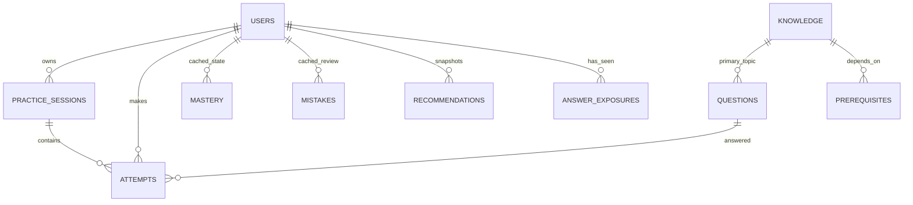

# 数据模型与算法说明

版本：rules-v1.0。这是可解释规则系统，不是机器学习模型；分数不是经真实学生数据校准的能力概率。

## 数据模型

| 实体 | 主要字段与用途 |
| --- | --- |
| users | 用户名、Argon2id 密码哈希、角色、演示标志、目标知识点 |
| auth_tokens | 随机令牌的 SHA-256 摘要、所属用户、12 小时到期时间；注销即撤销 |
| knowledge | 独立字符串 ID、subject、chapter、名称、说明、稳定排序位置 |
| prerequisites | knowledge_id + prerequisite_id 复合主键；表示“当前节点依赖先修节点” |
| questions | 主要计分知识点、辅助检索知识点、题干、四选项、答案、解析、难度、来源、启用状态 |
| practice_sessions | 所属用户、模式、筛选条件、请求题量、已派发题目 ID、结束状态与提示 |
| attempts | 用户、会话、题目、计分知识点快照、选择、正确性、有效日期、排除原因、幂等键、时间、模拟标志、判题响应快照 |
| answer_exposures | 用户/题目复合主键、首次答案返回时间，防止看答案后刷掌握度 |
| mastery | 用户/知识点复合主键、可重算窗口统计、当前难度、最近调整计数、历史通过时间 |
| mistakes | 用户/题目复合主键、可重算错误次数、最近错误与复习时间 |
| recommendations | 用户、规则版本、完整因子/贡献/推荐快照、创建时间 |

原始事实是 attempts 和题目版本。mastery、mistakes 是读模型缓存，管理员重算接口可重建；掌握度变化趋势和报告总量不另存冗余表，直接从历史计算。历史成就一旦授予即保留；图配置变化不会抹去旧成就。attempts.result 保留判题响应，以便幂等重试返回相同结果，不作为当前报告数据源。

## 答题事务与一致性

认证用户由服务端令牌确定；学生数据 API 不接收任意 user_id。会话 GET/提交明确校验所有权；管理员接口检查角色。题目公开接口仅输出允许字段；答案与解析仅在本人提交后出现在判题及本人会话历史中，管理员题库接口除外。

一次提交：锁定用户行 → 检查幂等与当前题目 → 服务端判题 → 保存尝试和首次曝光 → 重算掌握度/历史通过/难度 → 重算错题 → 根据最新状态派发下一题 → 保存推荐及响应快照 → 一次提交事务。异常由数据库会话回滚，不留下半条业务链。

唯一约束：`(user_id,idempotency_key)`、`(session_id,question_id)`、`(user_id,question_id,effective_day)`。同一请求重试返回原响应；同一键不同负载返回 409；同一会话不能修改已交答案。新的重复练习应建立新会话，从而保留新尝试但不重复计分。

MySQL 使用 READ COMMITTED，确保认证读操作之后、获得用户写锁的请求能读取此前已提交的记录。SQLite 用 WAL 和写事务串行化。管理员图编辑也通过管理员行锁串行化。JSON 验证全部成功才写入，导入过程中缺引用会整批拒绝。

题目已产生答题历史后，编辑创建新题目 ID，并归档旧题；旧答案和原计分知识点保持不变。未答题但已在进行中的会话派发的题目暂不允许原位编辑。不要直接修改数据库题目内容绕过版本逻辑。

## 知识路径

仅高中数学，14 节点：集合 → 定义域 → 函数求值 → 单调性；求值另分支到奇偶性；单调性分支到二次函数、指数函数、导数定义；指数与定义域共同先修对数；导数定义 → 导数计算；导数计算与求值共同先修切线；导数计算与单调性共同先修导数单调性 → 极值；极值与二次函数共同先修闭区间最值。

管理员保存整张候选图时执行 DFS 三色检测，拒绝自环、间接环和未知引用。章节只是展示归属，不能用章节 ID 代替知识点 ID。

## 有效记录和掌握度

服务端以 UTC 存储时间，按 APP_TIMEZONE（默认 Asia/Shanghai）确定计分日期。客户端不能指定日期或有效性。

- 同题同日最多一条有效记录。
- 首次判题返回即记录答案曝光。**只要该用户曾被返回此题答案，之后重复练习（包括次日）均不计入掌握度**；仍保存选择和错误/复习状态。这比“每天一次”更严格，避免跨日记答案刷分；可通过新题扩充有效样本。
- 每题只计主要知识点，辅助知识点只用于搜索。
- 按 created_at、id 排序，取该知识点最近最多 WINDOW=20 条有效记录。

`mastery = (correct + 1) / (n + 2)`。

n=0 返回 null，显示“未评估”，不显示 50%。报告同时展示 n 与不同题目数。全部答题正确率分母包含复习尝试，掌握度只使用有效记录，页面明确区分。

## 闯关

配置 PASS_DISTINCT=5、PASS_MASTERY=0.75。最近窗口至少 5 道不同题目、mastery≥0.75，且所有先修递归满足当前通过条件，才授予历史成就。5 道全对为 6/7≈85.7%，可以通过；只有 4 道全对即使比例足够，也不会通过。

当前状态：无样本为未评估；有样本未达条件为学习中；历史通过且当前满足为已通过；历史通过但自身或先修退步为建议复习。历史已通过节点不会重新锁定；推荐系统仍先处理当前先修缺口。自定义练习可提前诊断未解锁节点，但不会绕过通关前提。

初始化检查每点有效题库数量能否达到配置阈值，若全部答对仍无法通过则报错。管理员后续停用/新增内容时应检查题量；派题端会如实提示不足。

## 推荐

先只保留无当前先修缺口的节点（包括可复习的已通过节点），再评分。

`score = 0.5 × weakness + 0.3 × urgency + 0.2 × relevance`

| 因子 | 已评估 | 未评估/冷启动 |
| --- | --- | --- |
| weakness | 1−mastery | 固定诊断优先值 0.6；不是掌握概率 |
| urgency | min(距最近有效练习天数/7, 1)，下限为 0 | 0（不存在到期复习） |
| relevance | 当前目标=1，目标任意祖先=0.8，其余=0.2 | 相同规则 |

未设置目标：relevance 统一为 0.5；全新用户只开放学习起点，后续用稳定章节顺序冷启动。先修缺口采用递归可达关系，不推荐直接跳过缺失先修的目标。已掌握但久未练习的知识点可因复习紧迫度排名提高。

按 score 降序、position 升序、knowledge_id 字典序稳定排序。返回每个原始因子、加权贡献、总分、冷启动标志、版本、当前难度与自然语言理由；同时返回目标直接缺口和固定顺序基线。分数保留 6 位小数；在相同数据、相同时间参数下可复现，随真实时间变化的紧迫度会变化。

固定顺序基线：按章节排序选首个没有历史通过的节点。它只用于对比行为，不构成效果对照实验。模拟初始账号都沿顺序产生历史，首次输出可能与基线相同；制造已通过先修的复习退步后，可展示两种策略明显分歧。

## 难度

每知识点初始档位 1；只看最近最多 8 条有效记录。至少累计 5 条有效记录才允许首次调整；两次调整检查间隔至少 3 条新的有效记录。

- 正确率 <0.70：目标档位 1（基础）。
- 正确率 ≥0.70：目标档位 2（中等）。
- 窗口有 8 条、正确率 ≥0.85 且 mastery≥0.80：目标档位 3（提升）。
- 一次只变动一个档位，不能单题跳升到最高档。检查时记录累计有效计数，即使档位未变也进入冷却期。

自适应会话初始只派发一题，每次提交后重新排序并选下一题。先按推荐节点排序，在节点内优先未见题，然后选择距目标档位最近的难度，最后按难度、题号稳定排序。难度不足会提示替代；同一会话不重复派题。自定义模式严格遵守主要知识点、难度和题量，不足时实际减少，绝不填重复题。

## 局限性

- 原创演示题为 14 个参数化题型、每型 10 个不同数值实例，总计 140 题；基础/中等/提升为演示编排等级，尚未经真实学生难度校准，也不代表 140 种不同题型。独立数值测试验证答案，不能代替正式教研审查。
- 只覆盖函数与导数路径；不声称覆盖所有地区教材、完整高考内容或固定分值。无积分、假设检验等无依据分类。
- 固定权重和阈值没有真实效果验证，正确率不等于能力；不使用深度学习、IRT 或 BKT。
- 为便于审计，当前重算会扫描用户历史；适合演示规模，未做大规模性能压测。后续可增量更新并保留重放校验。
- 查看过答案后永不再次计分会使小题库容易耗尽，需要新增不同题目获取更多有效证据；提升题库多样性比放宽刷题规则更优先。
- 权限/并发有针对性测试，但不宣称完成渗透测试；公开部署需配置 TLS、域名反向代理、登录限流、备份及演示账号策略。无邮件找回密码、视频、OCR 或 AI 外部服务。
